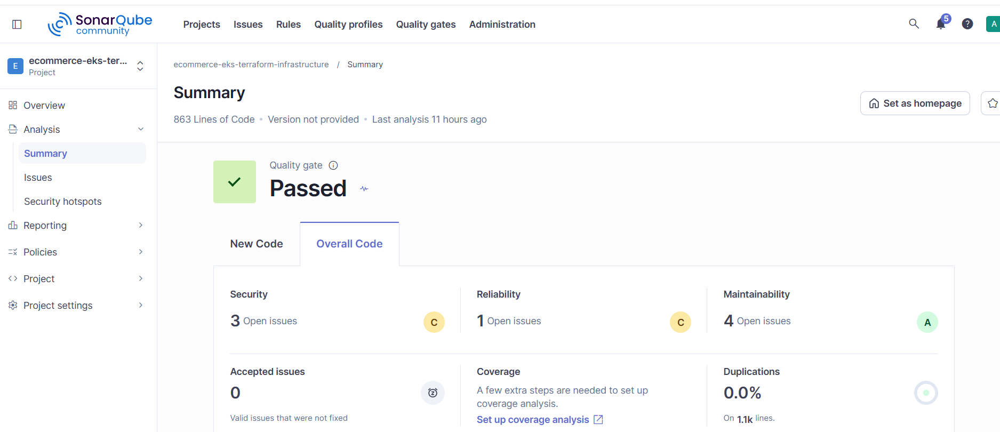
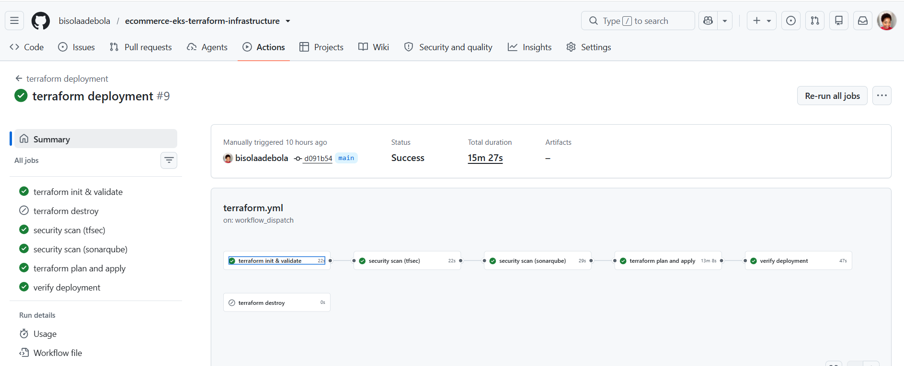

# Ecommerce EKS Terraform Infrastructure

**Author:** BisolaAdebola — DevOps Engineer

This repository contains the infrastructure-as-code and GitHub Actions workflow for deploying the ecommerce platform to Amazon EKS. It documents the infrastructure scanning and deployment phases of a three-phase DevSecOps project. The application build and GitOps deployment use the companion repositories listed below.

## Project phases

1. **Infrastructure scanning:** GitHub Actions runs tfsec and SonarQube analysis against this Terraform repository. The scan connects to a self-hosted SonarQube Community Edition server. That SonarQube server is itself provisioned on AWS EC2 with Terraform in the [SonarQube server repository](https://github.com/bisolaadebola/sonarqube-aws-ec2).
2. **Infrastructure deployment:** GitHub Actions authenticates to AWS with GitHub OIDC, initializes and validates Terraform, creates a plan, applies it, and checks that the EKS cluster and supporting services are ready.
3. **Application deployment:** The [DevSecOps platform repository](https://github.com/bisolaadebola/ecommerce-devsecops-platform) builds and pushes service images to Amazon ECR. The [Kubernetes manifests repository](https://github.com/bisolaadebola/ecommerce-kubernetes-manifests) supplies the desired state that Argo CD deploys to the cluster.

## Infrastructure managed here

Terraform provisions the AWS network, EKS control plane and node group, ingress and certificate components, persistent storage support, Argo CD, and kubeconfig storage. Terraform state is kept in an encrypted S3 backend with locking.

## GitHub Actions workflow

The `terraform deployment` workflow in `.github/workflows/terraform.yml` runs on pushes to `main` and can also be started manually.

- Initializes Terraform, checks formatting, and validates the configuration.
- Runs tfsec and SonarQube scans against the infrastructure code.
- Uses GitHub OIDC to assume an AWS IAM role, avoiding long-lived AWS access keys in GitHub secrets.
- Plans and applies Terraform, then verifies the EKS cluster, nodes, ingress, Argo CD, storage components, and kubeconfig output.
- Provides a manual `destroy` input for tearing down the Terraform-managed infrastructure.

The workflow uses the `SONAR_HOST_URL` and `SONAR_TOKEN` GitHub repository secrets to reach the self-hosted SonarQube server. AWS access is configured with the `AWS_OIDC_ARN` secret.

**Scan behavior:** In the current workflow, tfsec is configured with `soft_fail: true`, and the SonarQube step has `continue-on-error: true`. Findings are reported, but those settings allow the workflow to continue toward deployment even if a scan step fails.

## Self-hosted SonarQube server

The SonarQube server runs separately from the EKS cluster on an EC2 instance. Terraform automates its AWS infrastructure, including the host and networking. The server provides a self-hosted analysis endpoint for the infrastructure pipeline; its URL and analysis token are stored as GitHub Actions secrets rather than committed to source control.

### Phase 1 — SonarQube analysis

### Phase 2 — Terraform infrastructure deployment

## Repositories

- [Infrastructure: ecommerce-eks-terraform-infrastructure](https://github.com/bisolaadebola/ecommerce-eks-terraform-infrastructure)
- [SonarQube server: sonarqube-aws-ec2](https://github.com/bisolaadebola/sonarqube-aws-ec2)
- [Application build pipeline: ecommerce-devsecops-platform](https://github.com/bisolaadebola/ecommerce-devsecops-platform)
- [Kubernetes manifests: ecommerce-kubernetes-manifests](https://github.com/bisolaadebola/ecommerce-kubernetes-manifests)

